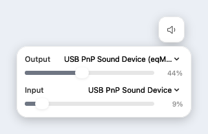

# VolumeMac

A compact macOS menu bar mixer for switching audio devices, adjusting output volume and microphone gain, and controlling apps individually. Version 0.7 uses a white mixer and floating shortcut with softer slider tracks.

## Controls

- Left-click the menu bar icon to open the mixer. **Output** and **Input** select the default devices. Level controls appear for devices that support software adjustment.
- Expand **App Volume** to see open apps with individual sliders and mute controls. This feature is experimental. Choose an output in an app’s row to send supported stereo audio to that device without changing the Mac’s default output. Choose **App Default** to clear the override. Overrides are kept for the current VolumeMac session and cleared if the selected device disconnects.
- Click **Show Floating Shortcut** to place a small speaker icon on the desktop. Click the speaker to open its controls beside it, or drag it out of the way.
- Right-click the menu bar icon to show or hide the shortcut or quit. You can also right-click the floating speaker to hide it.

## Screenshots


The desktop preview combines two VolumeMac captures on a blurred screenshot of the full desktop. The close-ups below show each control surface in detail.

<p>
  
  
</p>

## Build locally

Requires macOS 14.2 or later and the Xcode Command Line Tools.

```sh
./build.sh
open build/VolumeMac.app
```

The build is signed locally for development. This repository distributes the source and build instructions.

## Audio and privacy

Changing an app’s volume may prompt for macOS System Audio Recording access. VolumeMac processes the selected app’s audio in memory through Core Audio. It does not record or transmit audio. A session that cannot process audio is stopped so original playback can resume.

The native controls and window placement have been checked locally. Individual app playback and routing still need end-to-end verification.

## License

See [LICENSE](LICENSE) for personal use and redistribution terms.
