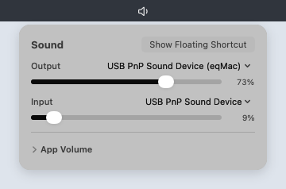

# VolumeMac

A compact macOS menu bar mixer for switching audio devices, adjusting output volume and microphone gain, and controlling apps individually.

## Controls

- Left-click the menu bar icon to open the mixer. **Output** and **Input** select the default devices. Level controls appear for devices that support software adjustment.
- Expand **App Volume** to see open apps with individual sliders and mute controls. This feature is experimental. It applies to supported stereo audio playing through the selected output.
- Click **Show Floating Shortcut** to place a small speaker icon on the desktop. Click the speaker to open its controls beside it, or drag it out of the way.
- Right-click the menu bar icon to show or hide the shortcut or quit. You can also right-click the floating speaker to hide it.

## Screenshots

The captures show VolumeMac’s own interface with the surrounding desktop omitted.

<p>
  
  
</p>

## Build locally

Requires macOS 14.2 or later and the Xcode Command Line Tools.

```sh
./build.sh
open build/VolumeMac.app
```

The build is signed locally for development. This repository distributes the source and build instructions.

## Audio and privacy

Changing an app’s volume may prompt for macOS System Audio Recording access. VolumeMac processes the selected app’s audio in memory through Core Audio. It does not record or transmit audio. A session that cannot process audio is stopped so original playback can resume.

The native controls and window placement have been checked locally. Individual app playback still needs end-to-end verification.

## License

See [LICENSE](LICENSE) for personal use and redistribution terms.
